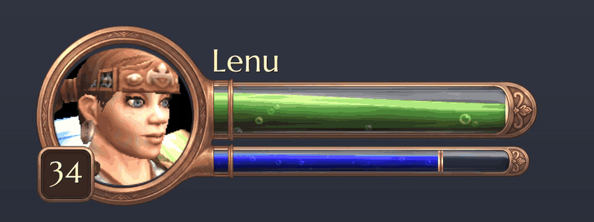

# Lucid Vials

Your player, target and target-of-target frames as bronze glass vials with living liquid, plus an experience tube. The
liquid sloshes when you run, turn or jump, settles when you stand still, glides to new values and leaves a glowing damage
trail. Hits, heals, mana regeneration and debuffs show as small effects inside the glass. Made for WoW Forever
(Interface 16001); it runs on Retail (Interface 120105) from the same download.

Lucid Vials reskins Blizzard's own frames. Clicks, the right-click menu, focus and Edit Mode stay Blizzard's; nothing is
secure-templated or replaced, so it works in combat. If another unit frame addon (ElvUI unit frames, Shadowed Unit Frames,
PitBull, XPerl and others) is loaded, Lucid Vials stays off. It runs on its own or together with
[Lucid](https://github.com/even512/Lucid).

## Usage

The frames are on after installation. `/vials` lists the commands, `/vials config` opens the settings window (also under
Options, AddOns, Lucid Vials).

- `/vials on|off` switches the frames, `/vials style piston|edge` picks the piston chamber or the plain liquid edge
- `/vials test` lets the values glide for a preview; `/vials test heal|hit|mana|poison|all|off` plays single effects
- `/vials xp on|off` turns the experience tube on or off, `/vials auren 14-36` sets the aura size on the target frame
- `/vials slosh on|off|<0-100>|damping <0-100>` tunes the sloshing, `/vials fx on|off` and `/vials debuffs on|off` the effects

Settings are saved in `LucidVialsDB`.

## Known problems

- On WoW Forever the game hides the debuff type during combat. The liquid then takes the color from the game's own debuff
  border (the debuff bar must be visible), and debuffs without a dispel type tint red, like the game's own border; the
  extras of each type (poison bubbles, streaks, darkening) appear only once the type is readable again, at the latest when
  combat ends.

## Development

Node 20 or newer. `npm install`, then `npm run check` (Lua 5.1 syntax and upvalue limit), `npm test` (vitest with a fengari
WoW mock), `npm run install-addon` (and `-- --retail`) to copy the addon into the game folder set in `.env` (`WOW_DIR=`, see
`.env.example`). `node scripts/build-package.mjs --out <folder>` rebuilds the release zip contents locally.

## License

Code: MIT. Graphics and media: all rights reserved. Font: SIL Open Font License. Details in `LICENSE` and
`addon/LucidVials/THIRD-PARTY.md`.
